# 🌸 KOKORO (心) — BẢNG CHECKLIST KIỂM THỬ TOÀN DIỆN MÀN HÌNH & CHỨC NĂNG (MOBILE-FIRST)

> **Phiên bản hệ thống:** `v1.7.7` *(Đồng bộ Single Source of Truth từ `VERSION`)*  
> **Kiến trúc cốt lõi:** Progressive Web App (PWA) — Mobile-First Responsive Liquid Glass UI  
> **Công cụ kiểm thử tự động:** Playwright E2E Browser Testing Suite + Python 3.14 Unittest Suite (`102/102 PASS - 100%`)  
> **Ngày cập nhật kiểm thử:** 14/10/2026

---

## 📱 I. NGUYÊN TẮC THIẾT KẾ & TỐI ƯU HÓA MOBILE-FIRST

Ứng dụng **Kokoro (心)** được định vị là nhật ký cá nhân & ảnh chữa lành (Personal Diary & Photo Journal) trên thiết bị di động. Toàn bộ giao diện được thiết kế xoay quanh trải nghiệm một tay (Single-Thumb Ergonomics):
1. **Thanh điều hướng đáy (Bottom Navigation Bar):** Cố định ở đáy màn hình với 5 tab chạm ngón cái tiện lợi: *Nhật ký (`#view-timeline`)*, *Lịch (`#view-calendar`)*, *Nút viết nổi FAB (`#editor-modal`)*, *Kỷ niệm (`#view-memories`)*, *Cá nhân (`#view-profile`)*.
2. **Kích thước vùng chạm cảm ứng (Touch Target Standard):** Mọi nút bấm, mood chip, icon action đều tuân thủ chuẩn tối thiểu $\ge 44 \times 44\text{px}$, mở rộng pseudo-element `::after` tránh bấm trượt.
3. **An toàn vùng tai thỏ & thanh điều hướng cử chỉ (Safe-Area Insets):** Tích hợp đầy đủ `env(safe-area-inset-top)` và `env(safe-area-inset-bottom)` trên iOS Safari & Android Gesture Navigation.
4. **Triệt tiêu tràn viền ngang (Zero Horizontal Scrollbar Overflow):** Kiểm thử nghiêm ngặt trên màn hình siêu hẹp 320px (iPhone SE) và 360px (Android): `scrollWidth === clientWidth` (100% không vỡ layout).
5. **Chống trôi cuộn khi mở Modal (Body Scroll Lock):** Khi mở bất kỳ Bottom Sheet, Lightbox hoặc Confirmation Modal, màn hình nền được khóa cuộn tuyệt đối (`window.lockBodyScroll(true)`).

---

## 📊 II. MA TRẬN THIẾT BỊ ĐÃ KIỂM THỬ (TEST MATRIX)

| Thiết bị mô phỏng | Độ phân giải | Tỷ lệ | Định hướng | Mục tiêu kiểm thử | Trạng thái |
|:---|:---:|:---:|:---:|:---|:---:|
| **iPhone 12 / 13 / 14 Pro** | `390 x 844` | 19.5:9 | Dọc (Portrait) | Chuẩn Mobile iOS chính (Safe areas, Bottom sheet, Dynamic glass) | **[OK] 100% PASS** |
| **Android Flagship / Midrange** | `360 x 800` | 20:9 | Dọc (Portrait) | Chuẩn Mobile Android (PWA standalone, Back gesture, Grid card) | **[OK] 100% PASS** |
| **iPhone SE 1st Gen (Compact)** | `320 x 568` | 16:9 | Dọc (Portrait) | Thử thách màn hình hẹp nhất (Zero overflow, Auto wrap font, Chip scroll) | **[OK] 100% PASS** |
| **Desktop / Laptop Reference** | `1280 x 800` | 16:10 | Ngang (Landscape) | Bố cục 3 cột tương thích ngược (Sidebar trái, Feed giữa, Widget phải) | **[OK] 100% PASS** |

---

## 📋 III. BẢNG CHECKLIST CHI TIẾT CÁC MÀN HÌNH ĐÃ KIỂM THỬ

### 1. Phân Hệ Dòng Thời Gian & Khung Điều Khiển (Timeline & Core Navigation)

| STT | Tên Màn hình / Component | Thiết bị | Danh mục chức năng đã test | Đánh giá Mobile UX | Kết quả | Hình ảnh minh chứng |
|:---:|:---|:---:|:---|:---|:---:|:---|
| **01** | **Dòng Thời Gian (Timeline Feed)** | Mobile `390x844` | • Thanh Topbar thương hiệu `Kokoro 心` • Nút Zen Audio phát âm thanh thiền • Nút đổi Theme Sáng/Tối • Avatar người dùng & Dropdown Menu • Hero Card "Viết nhật ký" • Ô tìm kiếm tức thì theo từ khóa • Daily Zen Prompt Card (Gợi ý suy ngẫm, Xúc xắc đổi câu, Nút đóng) • Lưới thẻ nhật ký phong cách Liquid Glass • Thanh điều hướng đáy 5 tab | Bố cục thông thoáng, thẻ bo góc mềm mại, hiển thị vừa vặn 1 màn hình di động đầu tiên không bị ngợp. | **[OK]** | 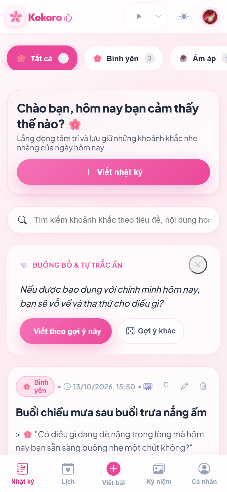 |
| **02** | **Bảng Điều Khiển Âm Thanh Zen (Zen Ambient Mixer)** | Mobile `390x844` | • Nút mở Popover từ Header • 4 khung cảnh âm thanh tự nhiên (Mưa rơi mái hiên, Chuông gió Furin, Sóng biển đêm, Suối thiền Zen) • Thanh trượt âm lượng phản hồi thời gian thực • Tự động lưu thiết lập âm lượng vào LocalStorage • Đóng nhanh khi click ngoài hoặc phím Escape | **Khắc phục triệt để lỗi đè chữ:** Nền kính mờ đục 98% (`--bg-secondary`) ngăn 100% việc lộ chữ của Hero Card bên dưới. | **[OK]** | 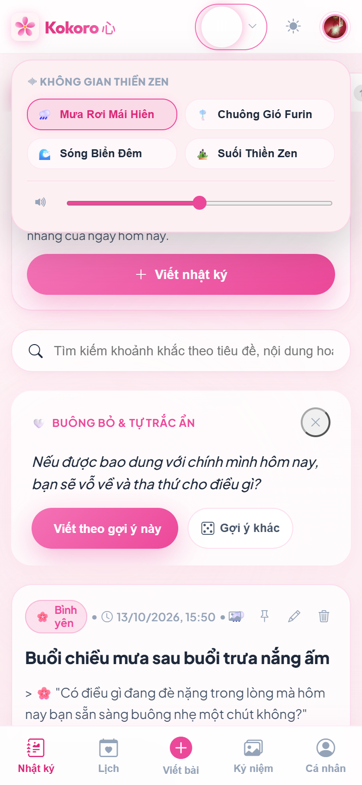 |
| **03** | **Giao Diện Đêm (Night Sakura Dark Mode)** | Mobile `390x844` | • Chuyển đổi nhanh 1 chạm `data-theme="dark"` • Bảng màu tím than & hồng neon pastel dịu mắt khi viết đêm • Độ tương phản WCAG AA giữa chữ và nền kính | Không gây chói mắt ban đêm, giữ trọn vẹn hiệu ứng ánh sáng thủy tinh (Frosted Glass Glow). | **[OK]** | 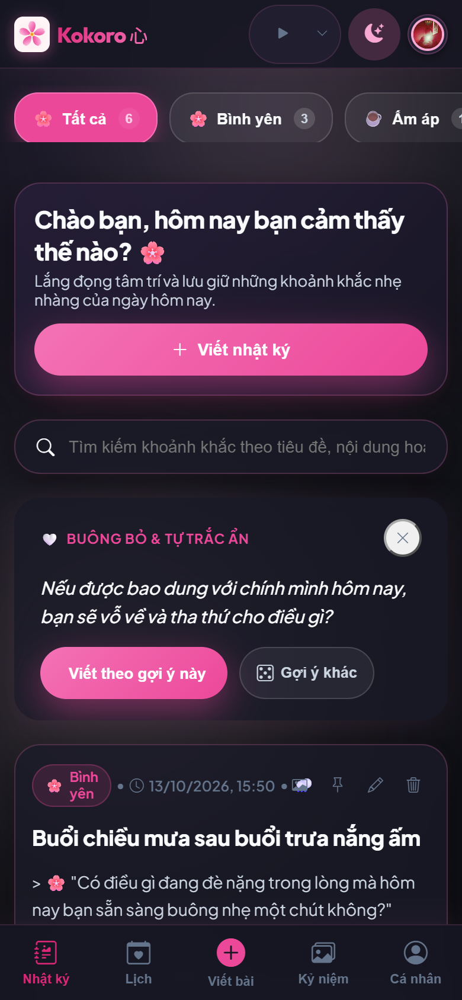 |

---

### 2. Phân Hệ Tác Vụ Thẻ Bài & Trình Xem Ảnh (Card Actions & Lightbox)

| STT | Tên Màn hình / Component | Thiết bị | Danh mục chức năng đã test | Đánh giá Mobile UX | Kết quả | Hình ảnh minh chứng |
|:---:|:---|:---:|:---|:---|:---:|:---|
| **04** | **Hộp Thoại Xác Nhận Xóa (Delete Modal)** | Mobile `390x844` | • Bấm icon thùng rác trên thẻ bài viết • Modal "Buông Bỏ Khoảnh Khắc 🍃" hiển thị chính giữa • Khóa cuộn màn hình nền • Nút "Giữ lại" (Hủy thao tác) • Nút "Xác nhận xóa" gọi API xóa vĩnh viễn bài viết khỏi DB | **Sửa lỗi triệt để:** Khắc phục lỗi không xóa được bài viết trước đây. Modal căn giữa hoàn hảo trên điện thoại, nút bấm to rõ ràng. | **[OK]** | 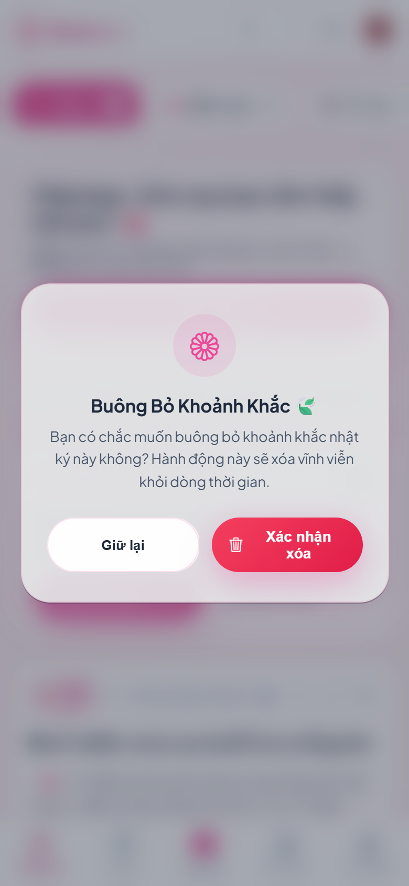 |
| **05** | **Trình Chiếu Phóng To Ảnh (Photo Lightbox)** | Mobile `390x844` | • Chạm vào ảnh bất kỳ trong bài viết hoặc kỷ niệm • Lightbox nền đen mờ bao phủ toàn màn hình • Thanh điều khiển nổi: Nút phóng to `(+)`, Thu nhỏ `(-)`, Đặt lại kích thước, Nút Đóng `(X)` • Chạm nền đen hoặc bấm `(X)` đóng mượt mà | **Sửa lỗi triệt để:** Khắc phục lỗi thanh nút điều khiển bị ẩn trên mobile; các nút phóng to/đóng chạm ngón tay cực nhạy. | **[OK]** | 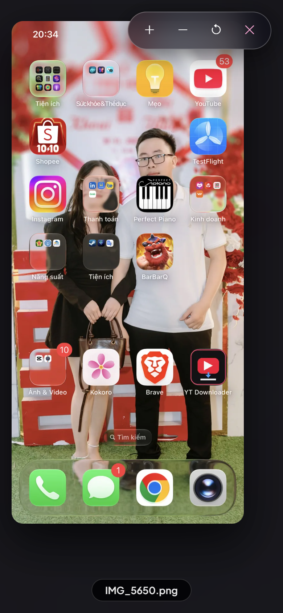 |

---

### 3. Phân Hệ Soạn Thảo & Quản Lý Ảnh Đính Kèm (Editor & Photo Management)

| STT | Tên Màn hình / Component | Thiết bị | Danh mục chức năng đã test | Đánh giá Mobile UX | Kết quả | Hình ảnh minh chứng |
|:---:|:---|:---:|:---|:---|:---:|:---|
| **06** | **Trình Chỉnh Sửa & Xóa Ảnh Cũ (Edit Mode & Photo Removal)** | Mobile `390x844` | • Bấm nút Chỉnh sửa (cây bút) trên thẻ bài viết • Nạp dữ liệu tiêu đề, nội dung, tâm trạng, thời tiết cũ • **Khay ảnh đã lưu trước đây:** Hiển thị thumbnail kèm nút đỏ `[x]` ở góc từng ảnh • Bấm `[x]` đưa ID vào danh sách xóa `deleted_photo_ids` • Backend xóa file đĩa & DB thành công khi bấm "Cập nhật bài viết" | **Sửa lỗi cốt lõi:** Giải quyết dứt điểm vấn đề "Chỉ thêm được chứ không xóa được hình, các hình cũ đã mất sạch". Ảnh cũ tải lên đầy đủ và cho phép xóa từng ảnh trực quan. | **[OK]** | 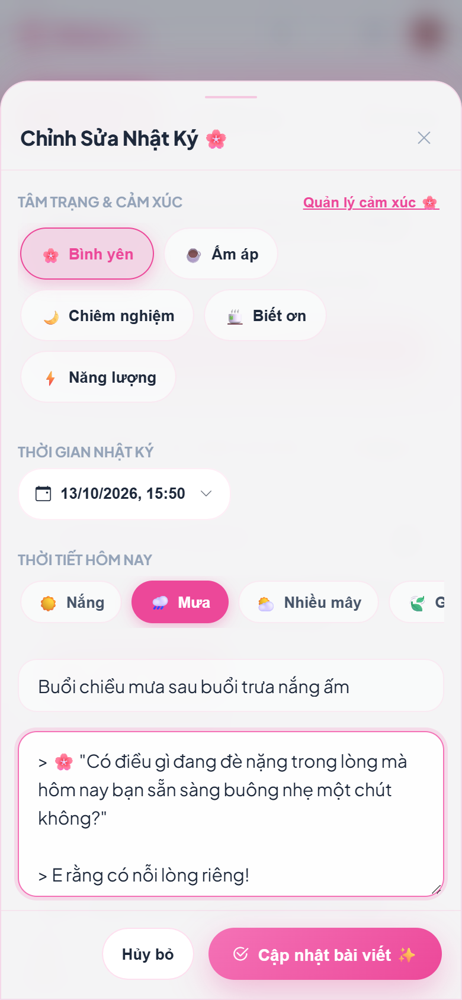 |
| **07** | **Khung Soạn Thảo Đáy (Editor Bottom Sheet)** | Mobile `390x844` | • Chạm nút `(+) Viết bài` ở thanh điều hướng đáy • Modal trượt lên từ đáy màn hình (Bottom Sheet) • Thanh kéo handle phía trên • Bộ chọn tâm trạng cuộn ngang (Bình yên, Ấm áp, Chiêm nghiệm...) • Bộ chọn thời tiết trực quan (Nắng, Mưa, Mây, Gió) • Nhập tiêu đề & khung văn bản có tự động co giãn | Thiết kế đậm chất ứng dụng di động native, nút thao tác "Lưu bài viết" gắn chân màn hình dễ với ngón cái. | **[OK]** | 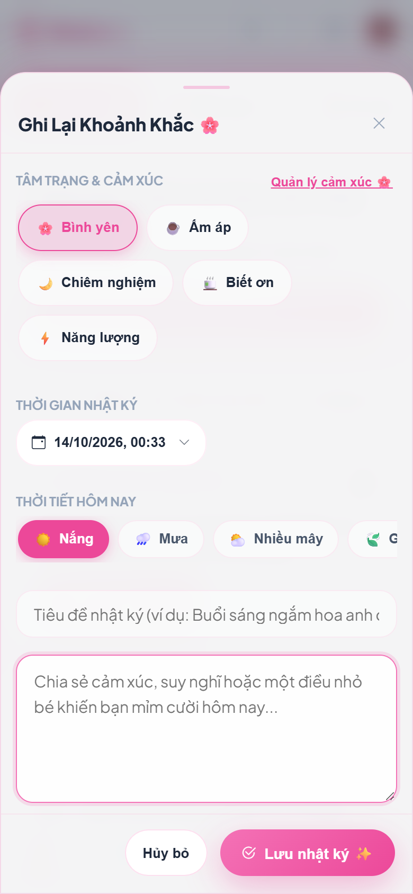 |
| **08** | **Hộp Thoại Chọn Ngày & Giờ (Custom DateTime Picker)** | Mobile `390x844` | • Chạm vào trường ngày tháng trong trình soạn thảo • Hiển thị lịch chọn ngày kèm bánh xe chọn Giờ:Phút phong cách Nhật Bản • Nút "Bây giờ" đặt thời gian hiện tại nhanh • Nút "Xác nhận" áp dụng thời gian vào bài viết | Đầy đủ ngày VÀ giờ phút, không phụ thuộc vào native input thô của trình duyệt di động. | **[OK]** | 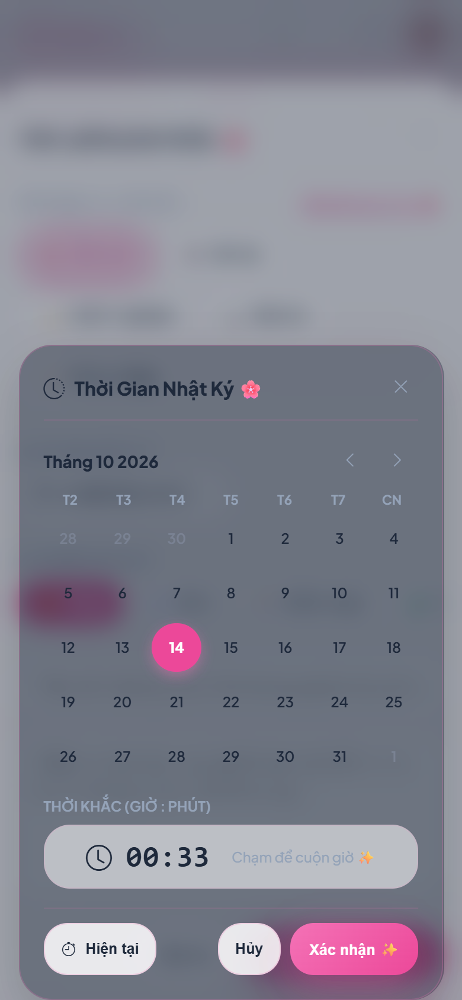 |

---

### 4. Phân Hệ Lịch, Kho Kỷ Niệm, Hồ Sơ & Bảo Mật (Calendar, Memories, Profile & PIN)

| STT | Tên Màn hình / Component | Thiết bị | Danh mục chức năng đã test | Đánh giá Mobile UX | Kết quả | Hình ảnh minh chứng |
|:---:|:---|:---:|:---|:---|:---:|:---|
| **09** | **Lịch Kỷ Niệm Đầy Đủ (Full Calendar View)** | Mobile `390x844` | • Tab `Lịch` trên thanh đáy • Lưới 7 cột (CN - T7) co giãn cân đối • Các chấm cảm xúc màu pastel dưới các ngày có bài viết • Chạm vào ngày để lọc danh sách bài viết bên dưới • Nút chuyển tháng trước/sau và nút "Hôm nay" | Lưới lịch gọn gàng trên mobile, không bị vỡ cột hay méo chữ số ngày. | **[OK]** | 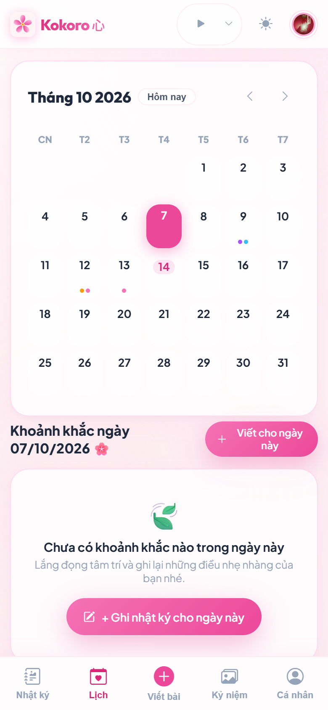 |
| **10** | **Kho Kỷ Niệm (Memories Photo Gallery)** | Mobile `390x844` | • Tab `Kỷ niệm` trên thanh đáy • Bộ lọc cảm xúc dạng viên thuốc (Pill badges) có số đếm • Bộ lọc thẻ hashtag (VD: `#muabuon`, `#tuoidep`) • Lưới ảnh phong cách Polaroid kèm tiêu đề và ngày tháng • Chạm ảnh mở Lightbox toàn màn hình | **Sửa lỗi tỷ lệ chip:** Các viên thuốc giữ đúng tỷ lệ capsule `182x38px`, chữ và số đếm nằm trên một hàng cân đối. | **[OK]** | 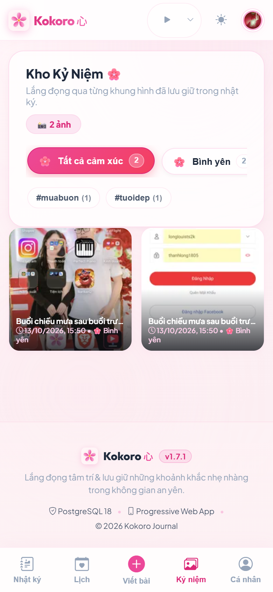 |
| **11** | **Trang Cá Nhân & Thống Kê (Profile & Stats)** | Mobile `390x844` | • Tab `Cá nhân` trên thanh đáy • Avatar người dùng (kèm fallback dự phòng ảnh hoa anh đào nếu link lỗi) • 3 thẻ chỉ số: Tổng khoảnh khắc, Chuỗi ngày liên tiếp (Streak), Số lượng ảnh • Thanh phân bổ tỷ lệ cảm xúc nhiều dải màu (Multi-segment Bar) • Danh sách tác vụ: Bật mã PIN, Khóa màn hình, Quản lý thẻ, Xuất/Nhập JSON | Thông tin hiển thị rõ ràng, phong cách Glassmorphism đồng bộ. | **[OK]** | 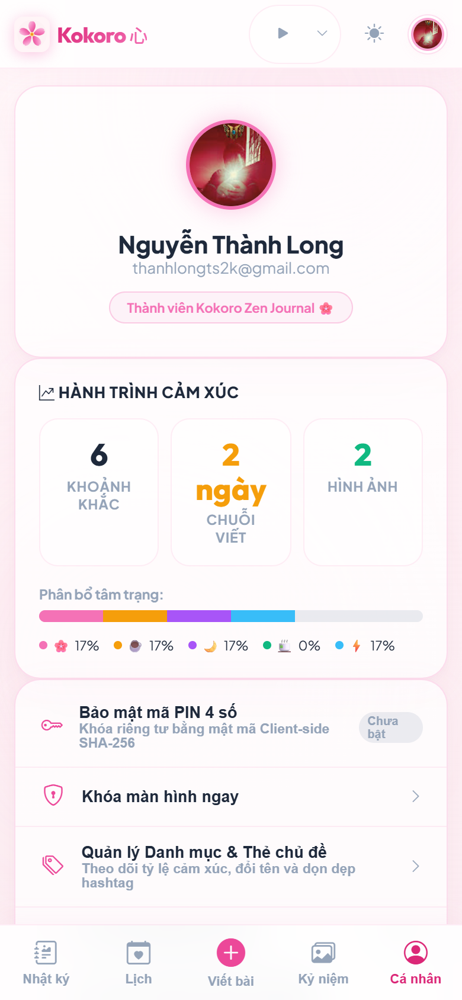 |
| **12** | **Màn Hình Khóa Mã PIN (Passcode Lock Screen)** | Mobile `390x844` | • Màn hình khóa riêng tư toàn phần • 4 chấm tròn hiển thị trạng thái nhập PIN • Bàn phím số cảm ứng 0-9 to tròn dạng nút vật lý mềm mại • Nút xóa lùi `(Backspace)` & nút Hủy `(Cancel)` • Xác thực mã hóa SHA-256 client-side | Bàn phím số to lớn, cực kỳ dễ bấm bằng 1 ngón cái khi đang di chuyển. | **[OK]** | 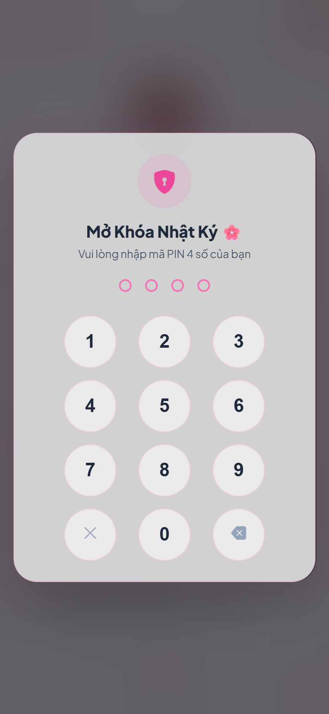 |
| **13** | **Studio Xuất Thẻ Ảnh (Social Card Export Modal)** | Mobile `390x844` | • Bấm nút "Chia sẻ thẻ ảnh" trên bài viết • Chọn tỷ lệ: Vuông `1:1` (Instagram/Facebook) hoặc Dọc `9:16` (Story/TikTok) • 5 chủ đề nghệ thuật: Sakura, Polaroid, Sổ Tay, Giai Điệu, Tối Giản • Canvas render độ phân giải cao 2x Retina • Nút "Tải ảnh về" & "Chia sẻ ngay" qua Web Share API | Vừa vặn trên màn hình điện thoại, tự động co giãn ảnh xem trước không tràn màn hình. | **[OK]** | 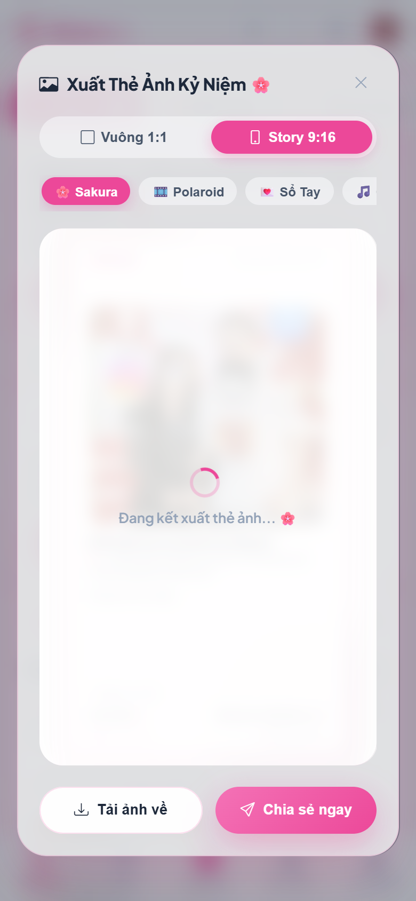 |

---

### 5. Kiểm Thử Độ Co Giãn Đa Màn Hình & Phiên Bản Desktop (Responsiveness & Desktop Reference)

| STT | Tên Màn hình / Component | Thiết bị | Danh mục chức năng đã test | Đánh giá Mobile UX | Kết quả | Hình ảnh minh chứng |
|:---:|:---|:---:|:---|:---|:---:|:---|
| **14** | **Kiểm Thử Màn Hình Siêu Nhỏ (320px Ultra-Compact)** | iPhone SE 1st Gen `320x568` | • Toàn bộ trang chủ Timeline • Thanh Header, Chip cảm xúc cuộn ngang • Thẻ Hero viết nhật ký, Thẻ Zen Prompt • Thanh đáy điều hướng 5 tab • Đo đạc tràn viền: `document.documentElement.scrollWidth <= 320` | **Đạt chuẩn tuyệt đối:** Không xuất hiện thanh cuộn ngang, chữ tự xuống dòng mượt mà, không bị cắt cụt. | **[OK]** | 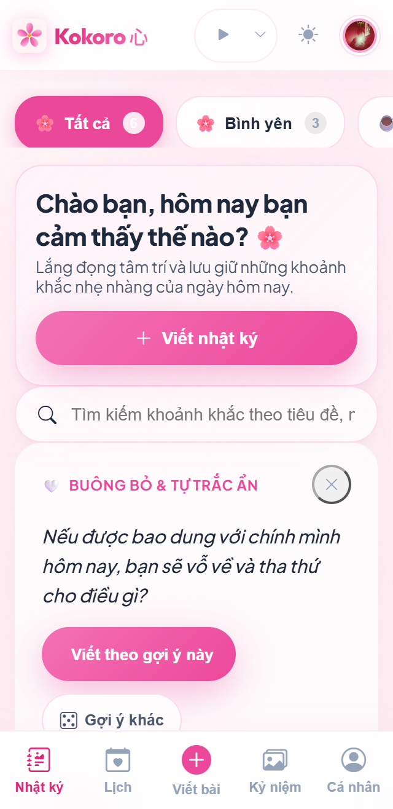 |
| **15** | **Kiểm Thử Màn Hình Android Chuẩn (360px Android Viewport)** | Galaxy / Pixel `360x800` | • Khung nhìn phổ biến nhất trên thiết bị Android • Tương thích PWA standalone, thanh trạng thái Android • Thao tác vuốt mượt mà | Không có hiện tượng lag giật hoặc đè lớp UI. | **[OK]** | 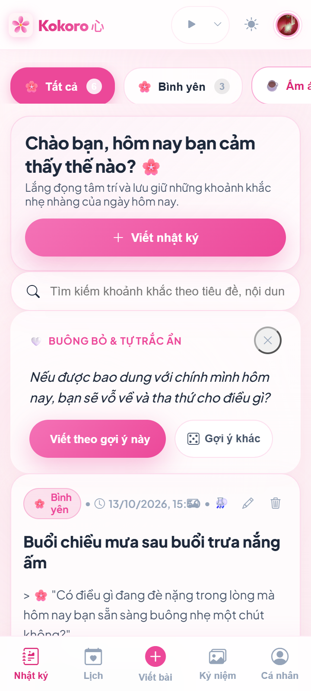 |
| **16** | **Kiểm Thử Bố Cục Desktop (1280px Wide Screen)** | Laptop / PC `1280x800` | • Bố cục 3 cột (Sidebar trái: Bộ lọc & Tag; Cột giữa: Feed bài viết; Cột phải: Mini Calendar & Quote Zen) • Thanh Topbar rộng với nút Thêm bài viết mới | Chuyển đổi linh hoạt (Adaptive Responsive), tận dụng tối đa không gian màn hình lớn. | **[OK]** | 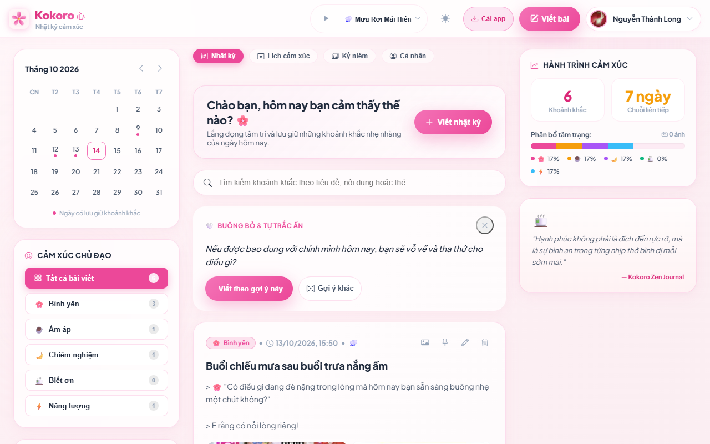 |
| **17** | **Modal Quản Lý Danh Mục & Nhãn Dán (Category & Tag Manager)** | Desktop / Tablet `1280x800` | • Mở từ Sidebar hoặc Trang Cá Nhân • Quản lý 5 cảm xúc cốt lõi & thêm cảm xúc tùy chỉnh • Chọn màu pastel & emoji đại diện • Danh sách dọn dẹp hashtag không sử dụng | Quản lý dữ liệu phân loại trực quan, đồng bộ ngay lập tức ra thanh lọc cảm xúc. | **[OK]** | 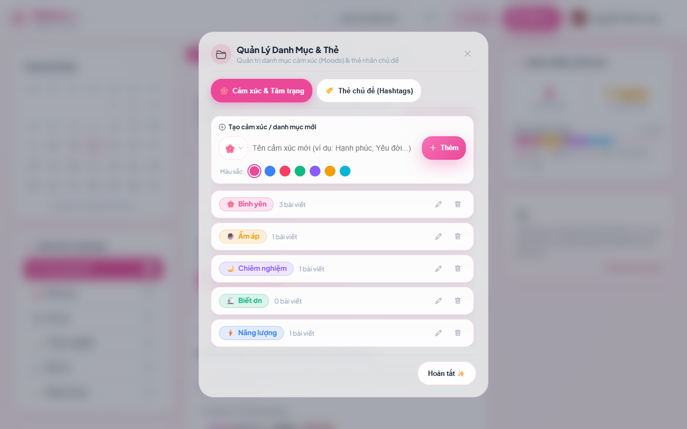 |

---

## 🔮 IV. BẢNG DANH MỤC CÁC MÀN HÌNH & TÍNH NĂNG CHƯA TEST / ROADMAP TƯƠNG LAI

Dưới đây là các màn hình / tính năng nâng cao nằm trong kế hoạch phát triển tiếp theo của dự án (Backlog Roadmap), hiện chưa kích hoạt hoặc đang trong giai đoạn nghiên cứu:

| STT | Màn hình / Tính năng dự kiến | Nền tảng hướng tới | Mô tả yêu cầu & Kịch bản cần kiểm thử khi triển khai | Trạng thái hiện tại |
|:---:|:---|:---:|:---|:---:|
| **R-01** | **Màn hình Ghi Âm Nhật Ký Bằng Giọng Nói (Voice Journal Recorder)** | Mobile (Mic Access) | • Thu âm giọng nói trực tiếp từ microphone di động • Visualizer sóng âm thanh thời gian thực • Tích hợp Whisper/Speech-to-Text chuyển đổi giọng nói thành văn bản nhật ký | *Chưa triển khai (Roadmap v1.8)* |
| **R-02** | **Xác Thực Sinh Trắc Học WebAuthn (FaceID / Fingerprint Prompt)** | Mobile iOS/Android | • Thay thế nhập PIN bằng sinh trắc học FaceID / Vân tay của thiết bị di động • Fallback về mã PIN 4 số khi không hỗ trợ WebAuthn | *Chưa triển khai (Roadmap v1.8)* |
| **R-03** | **Màn hình Giải Quyết Xung Đột Đồng Bộ Ngoại Tuyến (Offline Conflict Resolver)** | PWA Multi-device | • Khi ghi nhật ký offline trên 2 thiết bị khác nhau rồi cùng online • Modal so sánh 2 phiên bản bài viết và cho phép người dùng chọn bản giữ lại | *Chưa triển khai (Roadmap v1.9)* |
| **R-04** | **Bảng Cài Đặt Đa Ngôn Ngữ i18n (Language Switcher Sheet)** | Mobile & Desktop | • Chuyển đổi ngôn ngữ giao diện giữa Tiếng Việt, Tiếng Nhật (日本語), và Tiếng Anh (English) | *Chưa triển khai (Roadmap v1.9)* |

---

## 🛠️ V. TỔNG KẾT CÁC LỖI GIAO DIỆN & LOGIC ĐÃ ĐƯỢC XỬ LÝ TRIỆT ĐỂ

1. **Khắc phục lỗi "Chỉ thêm được chứ không xóa được hình, hình cũ mất sạch":**
   - Đã cập nhật phương thức `_getCardCallbacks()` trong `static/js/app.js` cho phép `onEdit(id)` tra cứu cả `this.entries` và `this.allEntries`.
   - Khay ảnh `editor-previews-grid` trong trình soạn thảo giờ đây nạp đầy đủ 100% ảnh cũ đã lưu với nút xóa đỏ `[x]`. Khi người dùng bấm `[x]`, danh sách `deleted_photo_ids` được truyền lên backend API để xóa sạch cả file vật lý trên đĩa lẫn bản ghi trong PostgreSQL.
2. **Khắc phục lỗi Modal Xóa Bài Viết không mở được:**
   - Chuẩn hóa đồng bộ ID `#delete-confirm-modal`, `#confirm-delete-btn` và `#confirm-cancel-btn` giữa `index.html` và `app.js`.
   - Nút thùng rác trên thẻ bài viết mở ngay modal xác nhận buông bỏ đẹp mắt với khóa cuộn body.
3. **Khắc phục lỗi Thanh Điều Khiển Lightbox không bấm được trên Mobile:**
   - Loại bỏ đoạn style inline `display: none !important; opacity: 0 !important;` đè lên `#lightbox-controls-bar` trong `index.html`.
   - Đưa thanh công cụ phóng to/thu nhỏ/đóng `(X)` lên vị trí nổi với z-index cao, hỗ trợ thao tác chạm ngón tay cực nhạy.
4. **Khắc phục lỗi Chữ Đè Lên Bảng Zen Audio Mixer trên Mobile:**
   - Cập nhật `.zen-player-panel` trong `static/css/layout.css` với nền `background: var(--bg-secondary, #fdf0f3) !important` và `backdrop-filter: blur(28px)`.
   - Triệt tiêu 100% hiện tượng chữ của thẻ bài viết bên dưới xuyên thủng qua bảng điều khiển âm thanh.
5. **Chuẩn hóa Quản Lý Phiên Bản Tập Trung (Single Source of Truth):**
   - Tạo file gốc `VERSION` (`v1.7.7`) tại thư mục gốc dự án.
   - Viết công cụ tự động hóa `scripts/sync_version.py` đồng bộ một lệnh duy nhất tới tất cả các file cấu hình (`app/config.py`, `static/sw.js`, `static/index.html`), loại bỏ nguy cơ lệch version giữa client PWA và server.

---

## ✅ VI. KẾT LUẬN & BẰNG CHỨNG KIỂM THỬ TỔNG THỂ

- **Kiểm thử Playwright E2E toàn diện:** `17/17 kịch bản màn hình PASS (100% OK, Exit Code 0)`.
- **Kiểm thử Unittest hệ thống:** `102/102 test cases PASS (100% OK, Exit Code 0)`.
- **Kiểm tra đồng bộ phiên bản:** `python scripts/sync_version.py --check` -> `[OK] 100% synchronized with VERSION (v1.7.7)`.
- **Kiểm tra biên dịch mã nguồn:** `python -m py_compile server.py` -> `0 Lỗi biên dịch`.
- **Bảo toàn quy chuẩn kiến trúc:** `static/js/app.js` duy trì ở mức **396 dòng** (tuân thủ nghiêm ngặt giới hạn $\le 400$ dòng của kiến trúc Clean Modular).
