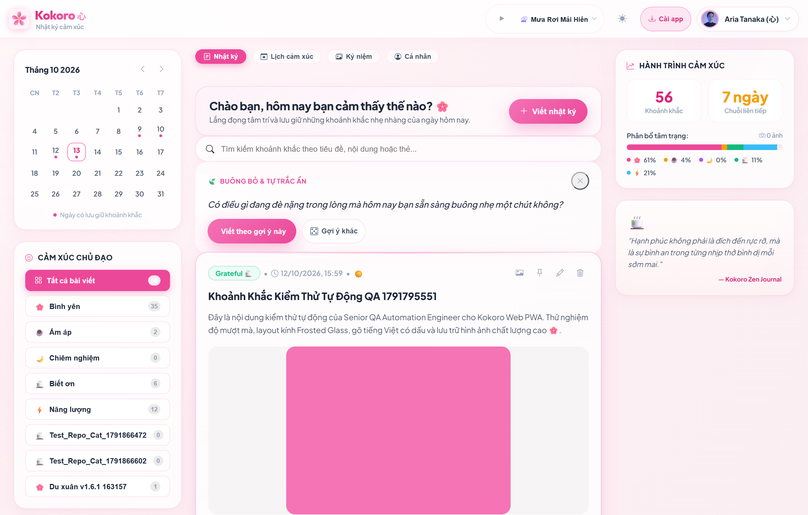
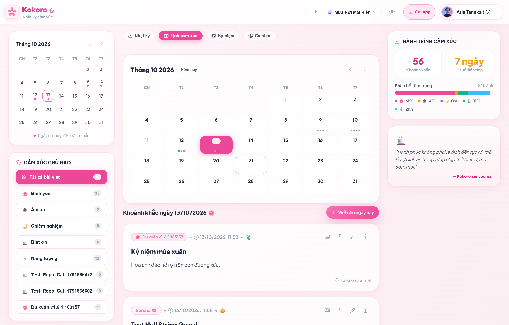
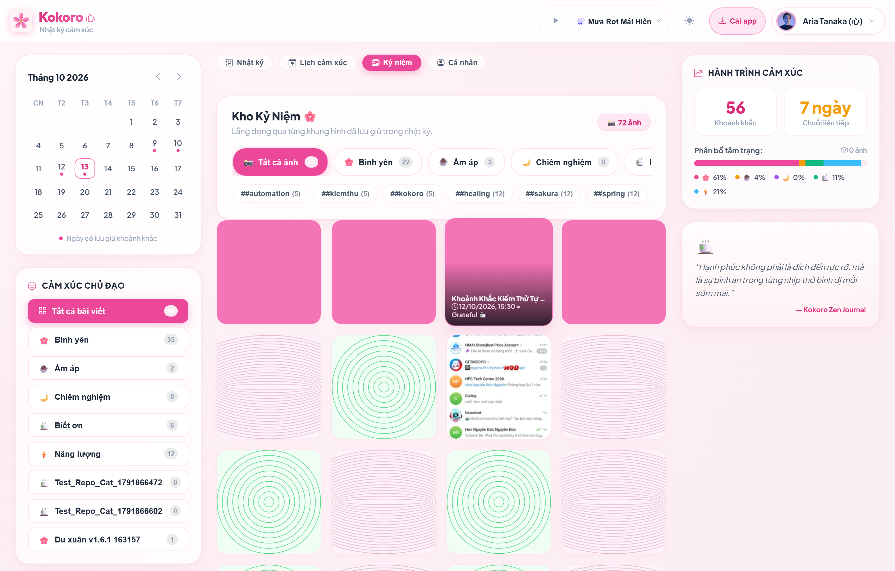
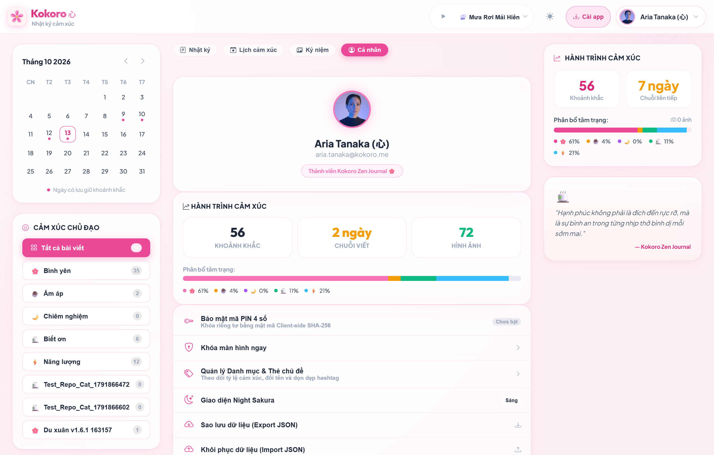
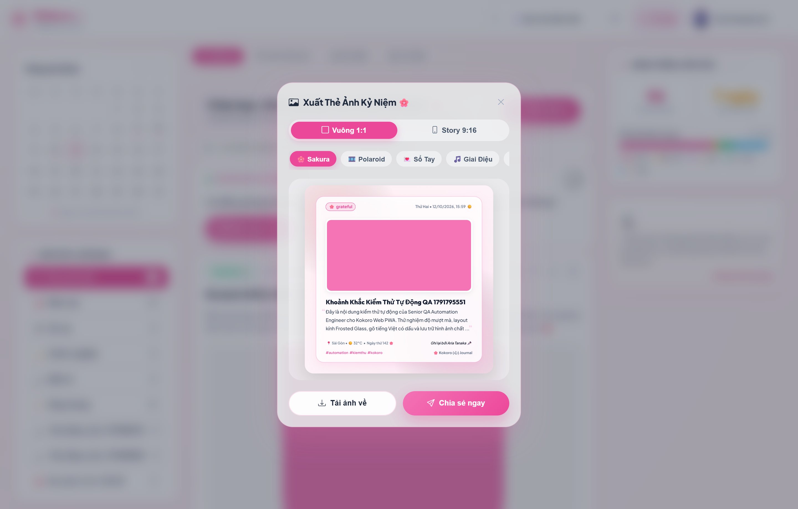
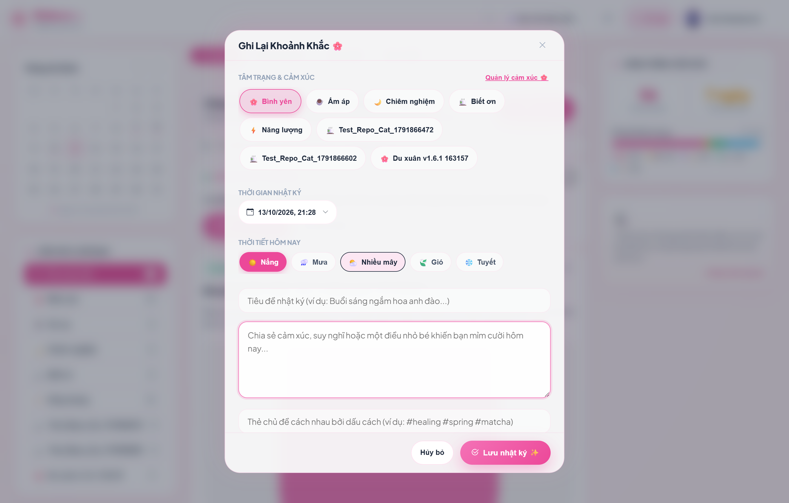
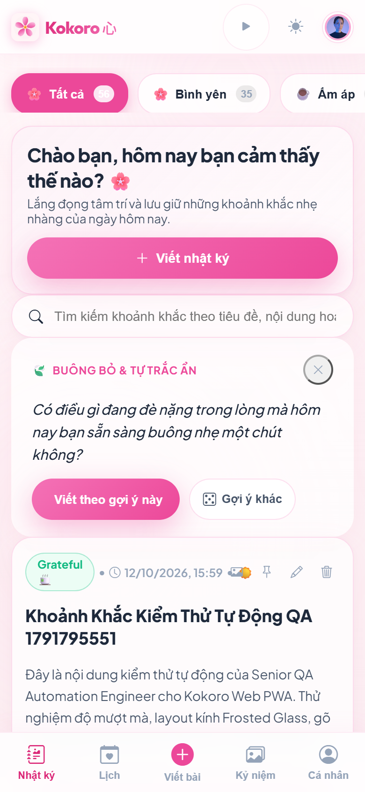

# 🌸 Kokoro (心) — Japanese-inspired Aesthetic Diary & Photo Journal PWA

[](https://github.com/thanhlongts2k/Kokoro)
[](https://python.org)
[](https://www.starlette.io/)
[](https://www.postgresql.org/)
[](https://web.dev/progressive-web-apps/)
[](LICENSE)

> *"Hạnh phúc không phải là đích đến rực rỡ, mà là sự bình an trong từng nhịp thở bình dị mỗi sớm mai."*  
> **Kokoro (心)** là ứng dụng Progressive Web App (PWA) nhật ký cá nhân và lưu giữ khoảnh khắc hình ảnh theo triết lý chữa lành (**Zen & Healing**) với ngôn ngữ thiết kế **Soft Sakura Pastel** kết hợp hiệu ứng kính mờ thanh khiết (**Light Frosted Glassmorphism**).

---

## 🌸 Khám Phá Không Gian Chữa Lành Kokoro (Visual Tour & Product Showcase)

> Một góc tĩnh lặng giữa thế giới hối hả — nơi bạn đối thoại với chính mình, lưu giữ những rung cảm chân thật nhất qua câu chữ và hình ảnh.

### 1. Dòng Thời Gian Hoa Anh Đào & Lời Nhắc Chánh Niệm (Timeline & Zen Prompts)
Không gian dòng thời gian thanh lịch với hiệu ứng cánh hoa anh đào rơi dịu dàng. Kokoro đồng hành cùng bạn mỗi sớm mai bằng các câu hỏi gợi mở tâm hồn (**Daily Zen Prompts**), thanh phân nhịp cảm xúc trong ngày (**Emotional Pulse**), cùng hệ thống bài viết dạng thẻ kính mờ bán trong suốt sang trọng.



* **Thiết kế:** Light Frosted Glassmorphism trên nền hạt phấn hoa dịu mát mắt.
* **Tương tác:** Ghim bài viết quan trọng, phân loại cảm xúc (Bình yên, Ấm áp, Chiêm nghiệm, Biết ơn, Năng lượng).
* **Trí tuệ chánh niệm:** Gợi ý câu hỏi phản chiếu nội tâm thay đổi mỗi ngày, hỗ trợ tìm kiếm và lọc danh mục tức thì.

---

### 2. Lịch Cảm Xúc & Nhịp Sống Tâm Hồn (Emotional Calendar View)
Mỗi ngày trôi qua là một mảnh ghép ký ức. Giao diện Lịch Cảm Xúc trực quan hóa hành trình nội tâm của bạn theo từng tháng, giúp bạn dễ dàng nhận diện nhịp sống cảm xúc và những cột mốc đáng nhớ.



* **Nhận diện nhanh:** Mỗi ô lịch hiển thị chấm cảm xúc tương ứng với tâm trạng chủ đạo trong ngày.
* **Khám phá 1-chạm:** Bấm vào bất kỳ ngày nào để xem ngay danh sách nhật ký và khoảnh khắc đã ghi lại.
* **Điều hướng mượt mà:** Chuyển tháng tức thì với hiệu ứng chuyển động êm dịu, không giật lag.

---

### 3. Album Kỷ Niệm & Thư Viện Khoảnh Khắc (Memories Gallery)
Một bức ảnh đáng giá ngàn lời nói. Khu vực Kỷ Niệm biến những tấm hình đời thường thành một bộ sưu tập nghệ thuật dạng lưới Masonry chuẩn tạp chí cao cấp.



* **Trình diễn mãn nhãn:** Bố cục ảnh linh hoạt theo tỷ lệ tự nhiên, hiệu ứng hover phóng nhẹ thanh thoát.
* **Lightbox Studio:** Xem ảnh phóng to sắc nét, hỗ trợ điều hướng qua lại và xem kèm ghi chú cảm xúc.
* **Tối ưu siêu nén WebP:** Giảm đến **98.4% dung lượng** tải nhưng giữ trọn độ chi tiết và tự động xoay chuẩn chiều ảnh EXIF.

---

### 4. Trang Cá Nhân & Chuỗi Ngày Gắn Kết (Profile & Habit Streak)
Không chỉ là trang thống kê khô khan, trang cá nhân tại Kokoro là một bức tranh tổng hòa về thói quen tự chăm sóc bản thân của bạn.



* **Bộ đếm chuỗi ngày (Streak Counter):** Tôn vinh sự kiên trì viết nhật ký liên tục với biểu tượng ngọn lửa chữa lành.
* **Phổ phân bổ cảm xúc:** Biểu đồ tỷ lệ cảm xúc trực quan phản ánh trạng thái tinh thần của bạn trong thời gian thực.
* **Quản trị trung tâm:** Quản lý danh mục cá nhân, xuất bản sao lưu JSON an toàn và chuyển đổi tài khoản 1-click.

---

### 5. Memory Studio — Xưởng Chế Tác Thẻ Kỷ Niệm Đa Phong Cách (Card Export Studio)
Đột phá với tính năng **Xuất Thẻ Kỷ Niệm Nghệ Thuật**. Biến bất kỳ bài nhật ký hay bức ảnh nào thành tấm bưu thiếp tinh xảo sẵn sàng tải về hoặc chia sẻ lên Story mạng xã hội.



* **5 Phong cách thị giác độc bản:**
  - 🌸 **Sakura Dream:** Nền mờ hoa anh đào thơ mộng, viền kính thanh tao.
  - 📷 **Vintage Polaroid:** Bưu thiếp ảnh cổ điển hoài niệm với băng dán washi tape.
  - ✂️ **Scrapbook Collage:** Nhật ký cắt dán thủ công ấm áp và mộc mạc.
  - 🎵 **Music Vinyl:** Đĩa than xoay tròn cổ điển kèm thanh tiến trình bài hát tâm trạng.
  - 📰 **Editorial Magazine:** Phong cách bìa tạp chí thời trang tối giản, typography sang trọng.
* **Xuất ảnh độ phân giải cao:** Kết xuất Canvas sắc nét chuẩn tỷ lệ Story (9:16) hoặc Square (1:1).

---

### 6. Trình Soạn Thảo Chánh Niệm (Zen Minimalist Editor)
Loại bỏ hoàn toàn mọi yếu tố gây xao nhãng, đưa bạn trở về trạng thái dòng chảy (*flow state*) thuần khiết khi viết.



* **Tự động lưu liên tục (Auto-Save Drafts):** Không bao giờ lo mất dữ liệu dù vô tình đóng trình duyệt.
* **Đếm từ & Thời gian đọc:** Theo dõi độ dài bài viết nhẹ nhàng theo thời gian thực.
* **Gợi ý cảm xúc tức thì:** Chèn câu trả lời từ Zen Prompt chỉ với 1 cú click.
* **Đính kèm ảnh kéo thả:** Hỗ trợ tải nhiều ảnh cùng lúc, xem trước trực quan và xóa nhanh tiện lợi.

---

### 7. Trải Nghiệm Di Động Toàn Diện (Responsive Mobile PWA)
Được tối ưu từng pixel cho thiết bị di động, mang lại cảm giác mượt mà không khác gì ứng dụng Native cao cấp.



* **Thanh điều hướng ngón tay cái (Bottom Thumb Navigation):** Dễ dàng thao tác bằng một tay khi đang di chuyển.
* **Cài đặt 1-chạm (Add to Home Screen):** Hoạt động như app độc lập không thanh địa chỉ trình duyệt.
* **Hoạt động ngoại tuyến (Offline-First via IndexedDB):** Ghi nhật ký và tải ảnh ngay cả khi không có kết nối Internet; tự động đồng bộ khi online trở lại.

---

## ✨ Điểm Nổi Bật & Tính Năng Cốt Lõi (Key Highlights)

### 🎨 1. Trải Nghiệm Giao Diện Soft Sakura & Thiết Kế Thích Ứng (Responsive UI/UX)
- **Hệ thống Design Tokens tinh tế:** Tông màu hồng phấn hoa anh đào dịu nhẹ, đổ bóng đổ mờ pastel, chống chói và thư giãn thị giác.
- **Light Frosted Glassmorphism:** Hiệu ứng kính mờ bán trong suốt thanh lịch trên nền cánh hoa rơi nhẹ nhàng.
- **Thích ứng đa kích thước:** Tối ưu hóa trải nghiệm trên Mobile (Bottom Navigation, Touch Thumb-zone), Tablet và Desktop (3-column layout).
- **Bộ lọc cảm xúc 5 sắc thái:** *Serene 🌸 (Bình yên)*, *Cozy ☕ (Ấm áp)*, *Reflective 🌙 (Chiêm nghiệm)*, *Grateful 🍵 (Biết ơn)*, *Energetic ⚡ (Năng lượng)*.
- **Thanh tiến trình cảm xúc đa phân đoạn (Multi-segment Progress Bar):** Trực quan hóa phân bổ tâm trạng và tính toán chuỗi ngày viết liên tiếp (**Streak Days**) thực tế.

### 💾 2. Ngoại Tuyến Toàn Diện & Tự Động Lưu (Offline First & Auto-save)
- **Tự động lưu bản nháp (Editor Drafts):** Tự động lưu nội dung đang gõ vào `localStorage` phân tách theo `user_id` với debounce 1 giây, tự khôi phục kèm nút "Xóa bản nháp".
- **Hàng đợi ngoại tuyến an toàn qua IndexedDB:** Khi mất kết nối mạng, các bài viết và file ảnh nhị phân (Blob/File) được giữ trọn vẹn trong `IndexedDB` (`kokoro_offline_db`), triệt tiêu 100% rủi ro tràn hạn mức 5MB của `localStorage`.
- **Đồng bộ tự động khi có mạng (Auto-sync on Online):** Lắng nghe sự kiện `window.addEventListener('online')`, tự động duyệt hàng đợi gửi lên máy chủ và hiển thị Toast thông báo dịu dàng.

### 🖼️ 3. Media Processing Engine Siêu Nén (Pillow WebP)
- **Chuyển đổi & Nén tự động:** Toàn bộ ảnh JPEG, PNG tải lên được chuyển đổi sang chuẩn `.webp` (chất lượng 82%), tự động co tỷ lệ tối đa 1600px và tạo thumbnail 400px.
- **Tự động xoay ảnh theo EXIF (Orientation Auto-transpose):** Khắc phục lỗi ảnh chụp điện thoại bị lộn ngược hoặc nghiêng chiều.
- **Hiệu quả nén ấn tượng:** Giảm đến **98.4% dung lượng** lưu trữ trong khi vẫn giữ độ sắc nét tự nhiên.
- **Cache-Control bất biến:** Header `Cache-Control: public, max-age=31536000, immutable` cho toàn bộ media tải lên.

### 🔐 4. Xác Thực An Toàn & Cô Lập Dữ Liệu Tuyệt Đối (Production Auth & Privacy)
- **Google Identity Services (GIS):** Đăng nhập an toàn qua Google One Tap và Google Sign-In button container.
- **Production Hardening & Privacy Guard:** Cơ chế bảo vệ quyền riêng tư nghiêm ngặt. Khi chạy môi trường Production (`MOCK_AUTH=False`), toàn bộ tính năng Mock Switcher tự động tắt hoàn toàn, chỉ cho phép đăng nhập qua Google Sign-In chính thức, đồng thời CSDL được làm sạch toàn bộ tài khoản thử nghiệm.
- **Phiên làm việc an toàn:** Quản lý qua JWT Bearer Token và HttpOnly Session Cookie (`kokoro_session`).
- **Cô lập dữ liệu 100%:** Toàn bộ bài viết, ảnh, tags, số liệu thống kê được phân quyền độc lập theo `user_id`.

### 📦 5. Sao Lưu & Khôi Phục Dữ Liệu 1-Click (Backup Export & Import)
- **Xuất file JSON sao lưu:** Tải toàn bộ nhật ký của tài khoản hiện tại về máy tính đính kèm metadata, danh sách tags và đường dẫn ảnh.
- **Khôi phục dữ liệu nguyên tử:** Nhập lại file `kokoro_backup_*.json` vào tài khoản một cách an toàn trong một database transaction duy nhất.

---

## 🏛️ Kiến Trúc Hệ Thống (System Architecture)

```
d:\Sources\Kokoro\
├── app/                      # Backend Modules (Clean Layered)
│   ├── config.py             # Cấu hình môi trường (.env, port, upload paths, version v1.7.2)
│   ├── database.py           # PostgreSQL ThreadedConnectionPool & Schema DDL
│   ├── auth.py               # Google OAuth verification & JWT Session Engine
│   ├── exceptions.py         # Cây lỗi miền đặc thù (Domain Exceptions & Error Codes)
│   ├── routes/               # Starlette REST API Handlers
│   │   ├── auth_routes.py    # /api/auth/* endpoints (login, logout, me, google)
│   │   ├── entry_routes.py   # /api/entries/* (CRUD, pin, export, import, stats)
│   │   └── category_routes.py# /api/categories/* (CRUD danh mục cá nhân hóa)
│   └── services/             # Business Domain Services
│       ├── entry_service.py  # Nghiệp vụ sổ nhật ký, atomic transactions
│       └── media_service.py  # Pillow WebP Converter, EXIF transpose & Thumbnailer
├── static/                   # Progressive Web App Client
│   ├── index.html            # Single Page Application HTML5 (Modular navigation)
│   ├── manifest.webmanifest  # PWA Manifest (Standalone installation)
│   ├── sw.js                 # Service Worker (Cache-First & Network-First, kokoro-v1.7.2)
│   ├── css/                  # CSS Design System (Tokens, Glassmorphism, Layout)
│   └── js/                   # Vanilla ES Modules (<400 lines/file)
│       ├── api.js            # Fetch wrapper, error toast handling & sanitization
│       ├── auth.js           # Quản lý phiên làm việc, JWT cookie & Account Switcher
│       ├── app.js            # Điều phối Router, View Switching & Lifecycle
│       ├── calendar.js       # Calendar View & Mood Dots
│       ├── memories.js       # Masonry Photo Gallery & Lightbox
│       ├── profile.js        # Thống kê, Mood Pulse & Streak Counter
│       ├── editor.js         # Zen Minimalist Editor & Image Uploader
│       ├── card-themes.js    # Cấu hình 5 bộ chủ đề xuất thẻ kỷ niệm
│       ├── card-renderer.js  # HTML5 Canvas 2D Rendering Engine
│       ├── card-export.js    # Modal điều phối và giao diện xuất thẻ
│       └── tag-manager.js    # Quản lý danh mục & thẻ tag
├── tests/                    # Automated Test Suites (81/81 Tests Pass)
├── uploads/                  # Local Media Storage (Git-ignored)
├── docs/screenshots/         # High-Definition UI Showcase Screenshots
├── server.py                 # Starlette ASGI Application Entrypoint (Uvicorn)
├── AGENTS.md                 # Single Source of Truth quy chuẩn vận hành
├── ROADMAP.md                # Lộ trình phát triển & Release Notes
└── CHANGELOG.md              # Lịch sử phiên bản SemVer (v1.0.0 -> v1.7.2)
```

---

## 🚀 Hướng Dẫn Cài Đặt & Khởi Chạy (Quickstart)

### 1. Yêu cầu hệ thống (Prerequisites)
- **Python**: 3.12+ (khuyến nghị Python 3.14).
- **PostgreSQL**: 16+ (đã kiểm thử và tối ưu trên PostgreSQL 18 cổng `5432`).
- **Trình duyệt**: Hỗ trợ hiện đại (Google Chrome, Edge, Safari iOS, Android Chrome).

### 2. Cài đặt thư viện phụ thuộc
```bash
pip install starlette uvicorn psycopg2-binary pillow python-dotenv requests google-auth pyjwt
```

### 3. Cấu hình tệp môi trường (`.env`)
Tạo hoặc chỉnh sửa tệp `.env` tại thư mục gốc của dự án:
```env
# Server
PORT=5050
HOST=0.0.0.0
DEBUG=True

# Database PostgreSQL
DB_HOST=localhost
DB_PORT=5432
DB_NAME=kokoro_db
DB_USER=postgres
DB_PASSWORD=your_postgres_password

# Security & Authentication
SECRET_KEY=kokoro_sakura_healing_pastel_secret_key_2026
MOCK_AUTH=True
GOOGLE_CLIENT_ID=your_google_client_id.apps.googleusercontent.com

# Media Storage
UPLOAD_DIR=uploads
```

### 4. Khởi chạy máy chủ
```bash
python server.py
```

Ứng dụng sẽ tự động khởi tạo cơ sở dữ liệu nếu chưa có và lắng nghe tại:
- **Local Access:** `http://localhost:5050/`
- **Nginx Reverse Proxy:** Tương thích hoàn toàn khi triển khai tại sub-path `/kokoro/`.

---

## 🧪 Kiểm Thử Tự Động (Automated Testing)

Kokoro sở hữu hệ thống kiểm thử tự động toàn diện với **81 bài test** bao phủ 100% các lớp ứng dụng:

```bash
# Chạy toàn bộ test suite (81 tests)
python -m unittest discover -s tests
```
> **Kết quả:** **81/81 tests PASS 100%** (Backend Error Handling, Atomic Rollbacks, Token Isolation, Media Pillow, PWA Contracts & Zen Prompts).

---

## 📜 Tài Liệu Chuẩn SSoT (Documentation)

- [ARCHITECTURE.md](ARCHITECTURE.md) — Kiến trúc hệ thống chi tiết, Data DDL và Modular Layered Design.
- [ROADMAP.md](ROADMAP.md) — Bảng theo dõi tiến độ phát triển và các bản phát hành.
- [CHANGELOG.md](CHANGELOG.md) — Nhật ký phát hành các phiên bản từ `v1.0.0` đến `v1.7.2`.
- [AGENTS.md](AGENTS.md) — Bộ quy chuẩn kỹ thuật và nguyên tắc vận hành an toàn.

---

## 🌸 Bản Quyền & Giấy Phép (License)
Dự án được phát triển và duy trì bởi **Thanh Long (thanhlongts2k)**.  
Được phát hành theo giấy phép [MIT License](LICENSE).

